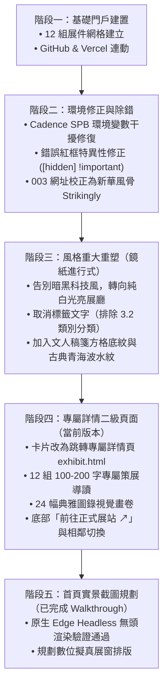

# 「鏡紙進行式」數位策展門戶 · 全對話歷程與系統整合報告

> **元智大學中國語文學系 112 級實務製作成果展**  
> **Mirror · Paper · In Progress** — 線上數位策展門戶整合全紀錄

---

## 📑 目錄
1. [專案背景與核心理念](#一專案背景與核心理念)
2. [對話演進與版本歷程](#二對話演進與版本歷程)
3. [十二組展件完整策展矩陣](#三十二組展件完整策展矩陣)
4. [系統架構與程式碼結構](#四系統架構與程式碼結構)
5. [關鍵技術突破與安全性](#五關鍵技術突破與安全性)
6. [維運手冊與常用指令](#六維運手冊與常用指令)
7. [未來升級與擴充藍圖](#七未來升級與擴充藍圖)

---

## 一、專案背景與核心理念

本專案為**元智大學中國語文學系 112 級實務製作成果展**之官方數位策展門戶，旨在打破傳統中文系予人安靜古籍、純粹紙本的刻板印象，將古典文學、文字學、文化研究與當代數位科技、互動遊戲、影像美學深度結合。

### 策展主題：「鏡紙進行式」
- **「紙」**：象徵文字的載體與記憶的積累。從古典簡冊、尺牘、奏章到現代書信、稿紙，亦象徵大學畢業生如同純白之紙，即將轉身迎向人生新章節。
- **「鏡」**：源自唐太宗「以銅為鏡、以古為鏡、以人為鏡」之思辨。鏡既能反射外貌與當下心境，亦能將古典文學透過現代數位科技折射再現。
- **「進行式」**：代表進行（-ing）與動態前行。全展以動靜結合的方式，展現文學具備強大的生命力與對話可能。

---

## 二、對話演進與版本歷程

本專案歷經數次重要的視覺理念重塑與功能迭代，詳細歷程如下：



### 重大決策節點清單：
1. **GitHub 與 Vercel 連動**：建立 `main` 分支自動觸發 Vercel 生產環境佈署機制。
2. **環境變數修復**：修正 Windows 系統中 Cadence SPB 覆寫 `$env:HOME` 導致 Git 無法識別全域設定之問題。
3. **取消標籤文字（「不要 3.2」）**：移除生硬的分類標籤，使卡片回歸純粹的題名美學。
4. **背景紋樣升級**：因應「背景過於單調」之反饋，疊加 $40\text{px} \times 40\text{px}$ 文人方格稿箋與青海波（Seigaiha）水鏡紋飾。
5. **導覽動線革新**：依據最新需求，將「點擊卡片直接外連」重構為「進入二級詳情頁（包含 100–200 字介紹、1–2 張展示圖錄），確認後再外連至正式展站」。

---

## 三、十二組展件完整策展矩陣

| 編號 | 展件完整題名 | 策展導讀概述（100–200字） | 正式展站網址 |
| :---: | :--- | :--- | :--- |
| **001** | 字裡行間的女性：女字旁漢字字源與女書文化研究 | 本展件深入探索漢字中「女」字旁的文字源流、演變歷史與性別意涵，並對湖南江永獨特的女性專用文字「女書」進行文化梳理與數位互動展示。透過文字學的嚴謹考據與現代視覺互動，解構歷史語境中女性被賦予的多重形象，帶領觀者走入文字背後的幽微心事與歷史話語權。 | [線上展站](https://grad-project-nushu.vercel.app/) |
| **002** | 青史有眾生｜中語系畢業製作 | 跳脫傳統帝王將相的宏大歷史敘事，將視角回歸歷史長河中的平民百姓、無名匠人與市井群體。透過生動的文學筆觸與互動策展，還原市井生活的柴米油鹽與悲歡離合，展現歷史深處最真實的眾生百態。文字不僅記載王道霸業，更為無聲的眾生留下一抹溫熱的痕跡。 | [線上展站](https://lighthearted-monstera-2747a5.netlify.app/) |
| **003** | 新華風骨｜新中式文化美學與互動抽籤 | 融匯古典華夏風骨與現代互動設計的美學實驗。以「新中式」意象為基底，結合傳統占卜、籤詩典故與現代心靈對話，讓參觀者在數位抽籤互動中領略古典辭章的哲理與文化自信。每一道靈籤皆為一面映照當下心境的明鏡，在虛實交錯間尋訪內心的安頓之所。 | [線上展站](https://inhuafenggu-official112.mystrikingly.com/contact) |
| **004** | 亞洲織夢｜Threads of Asia 傳統服飾文化探尋 | 穿越千年絲路的織造文化之旅。本展件匯聚亞洲多民族的傳統服飾、織品紋樣與刺繡工藝，解析經緯交錯間所蘊含的地理風土、社會階層與人文記憶，展現東方服飾文化的精湛底蘊與美學魅力。透過衣履的線條與色彩，織就一部流動的亞洲文明記憶史。 | [線上展站](https://threads-of-asia.aa0966357068.chatgpt.site/#home) |
| **005** | 鴻雁遺音 — 寫給時間的一封信 | 以古典尺牘與現代書信為載體，寄託對歲月流轉的深情凝望。透過文字將個人情感、時光遺憾與生命哲思封存入信，探討書寫在人際連結與自我療癒中的恆久力量。展站藉由泛黃紙頁與時光郵筒意象，喚醒觀者心中塵封的真摯記憶與未寄之語。 | [線上展站](https://flmj0ssz-staging.b12sites.com/) |
| **006** | 城市裡的透明人｜當我們願意看見彼此 | 聚焦現代繁華都市邊緣的弱勢與邊緣族群，以文學寫作與社會紀實視角凝視那些被日常忽視的「透明人」。藉由真摯的訪談與故事再現，喚起社會大眾的同理心，在冷漠的鋼筋水泥中看見彼此的溫度。文字成為光束，映照出隱沒在霓虹陰影下的真實生命力。 | [線上展站](https://see-hidden-city.base44.app) |
| **007** | 墨陣爭鋒｜歷史集換式卡牌遊戲 | 將中國古代歷史戰役與文臣武將轉化為高策略性的集換式卡牌（TCG）遊戲。結合歷史典故、陣法兵略與角色技能設計，使玩家在指尖對弈的「墨陣」中，身歷其境體驗兵戈縱橫的智謀對決與文化魅力。水墨線條躍然紙上，演繹一場智勇兼備的歷史博弈。 | [線上展站](https://funny-lily-05e474.netlify.app/) |
| **008** | 古韻映象館｜以詩入境，以影留韻 | 古典詩詞與現代影像藝術的跨界對話。以古典詩詞意境為骨架，融合攝影構圖與光影流轉，將抽象的古典詩意具象化為一幕幕視覺饗宴。帶領觀者步入「以詩入境，以影留韻」的沉浸式美學空間，探索傳統文人抒情傳統在當代影像語彙中的轉化與再生。 | [線上展站](https://guyunyingxiangguan-ae6ufk.webnode.page/) |
| **009** | 王政殺機｜古典文學桌遊企劃 | 以先秦列國與歷代王室權力鬥爭為背景的陣營推理桌遊。結合古典歷史文獻與懸疑心理戰機制，玩家將扮演君王、謀士與刺客等多元角色，在朝堂暗湧與殺機四伏中博弈決策，考驗策略與歷史洞察力。以遊戲作為媒介，重現古典政治史上的風雲變幻。 | [線上展站](https://wodewangzhan-n85wg1.webnode.page/) |
| **010** | 東方神諭｜古典文學 × SDGs 塔羅桌遊 | 創新融合古典文學智慧與聯合國永續發展目標（SDGs）的哲學桌遊。將東方神話傳說、哲人思想與現代全球議題轉化為塔羅牌卡，讓玩家在啟發性的卡牌推演中，探索古典文化如何回應當代世界永續發展的挑戰。兼具寓教於樂與深邃的思辨價值。 | [線上展站](https://marvelous-lamington-89589d.netlify.app) |
| **011** | 「元」來如此：曲中有新／心聲 | 解構元代散曲與雜劇的市井精神與生命自白。深入剖析元曲擺脫傳統雅正束縛後的率真與詼諧，對照當代年輕世代的心境與社會觀察，呈現古典曲調在新時代所碰撞出的心靈共鳴與嶄新詮釋。讓沉寂的古曲唱出當代青年最真實的心底之聲。 | [線上展站](https://reurl.cc/RRmvLg) |
| **012** | 《紅樓夢求生指南》｜紅樓夢：一入賈府 | 以當代互動敘事與RPG生存視角切入經典名著《紅樓夢》。引領玩家化身初入大觀園的局中人，在錯綜複雜的家族禮法、人際網絡與命運伏筆中做出抉擇，體驗古典文學巨著的深邃人性與豪門悲歡。以趣味互動拉近經典名著與現代讀者的距離。 | [線上展站](https://hongloumeng-ahsdey3c.manus.space) |

---

## 四、系統架構與程式碼結構

專案採用嚴謹的純靜態架構，無任何 Node.js 建置相依，具備極高的載入效能與易維護性。

### 檔案目錄索引
```
c:\Users\YzuUser\Desktop\webrec\
├── index.html          # 主展廳入口：哲學宣言、搜尋欄、聚光燈、12 組卡片展示
├── exhibit.html        # 專屬二級詳情頁：導讀內文、圖錄展出、外網連結、雙向導覽
├── style.css           # 鏡紙設計系統、方格稿箋底紋、青海波水紋、擬真邊框
├── app.js              # 首頁互動邏輯：即時檢索、聚光燈、安全卡片生成
├── exhibit.js          # 詳情頁核心控制器：URL 路由解析、內容裝配、前後展件切換
├── exhibits.json       # 12 組展件標準資料庫（包含 ID、導覽、圖錄、外網 URL）
├── exhibits-data.js    # 離線/file:// 協議安全備援資料層
├── assets/
│   └── images/         # 24 幅展件專屬視覺圖錄典藏（SVG 向量格式）
├── README.md           # 專案概觀說明書
└── PROJECT_SYNTHESIS.md # 本份全對話綜合彙整報告
```

---

## 五、關鍵技術突破與安全性

1. **雙軌自適應資料載入架構（Dual-Track Data Architecture）**：
   - 線上環境（`http://` / `https://`）自動透過非同步 `fetch('exhibits.json')` 載入最新資料。
   - 本地環境直接雙擊（`file:///`）時，為避免瀏覽器 CORS 策略攔截，自動無縫切換由 `exhibits-data.js` 注入之全域記憶體資料，達成「零伺服器即開即用」。
2. **零 XSS 防禦性 DOM 構建**：
   - 全面摒棄危險的 `innerHTML` 直接字串拼貼使用者或遠端文字，全面採用 `textContent` 與原生 DOM API，杜絕任何惡意代碼注入風險。
3. **白名單 URL 校驗機制**：
   - 建立 `isValidHttpUrl()` 嚴格檢查，僅允許 `http://` 與 `https://` 協議，杜絕 `javascript:` 或非預期協議引發之安全性威脅。
4. **決定性視覺演算法（Deterministic Identity Hashing）**：
   - 透過 DJB2 演算法針對展件標題字串進行雜湊運算，在無人工干預下自動生成一致且調和的色彩微調與幾何背景。

---

## 六、維運手冊與常用指令

### 1. 手動更新展覽資料與推送 GitHub 指令
當您修改了文案、網址或新增圖片後，請在 PowerShell 中依序執行以下指令：

```powershell
# 1. 確保使用者環境路徑指向正確的 UserProfile
$env:HOME = $env:USERPROFILE

# 2. 切換至專案根目錄（若尚未在目錄內）
cd c:\Users\YzuUser\Desktop\webrec

# 3. 查看目前檔案更動狀態
git status

# 4. 暫存所有變更
git add .

# 5. 提交版本紀錄
git commit -m "feat: 更新展覽內容與圖錄設定"

# 6. 推送至遠端 GitHub main 分支（自動觸發 Vercel 線上重新佈署）
git push origin main
```

### 2. 本地預覽方法
- **方法 A**：直接在檔案總管中對 `index.html` 按兩下，使用任何瀏覽器開啟。
- **方法 B**（靜態伺服器模式）：
  ```powershell
  python -m http.server 8000
  # 接著開啟瀏覽器前往 http://localhost:8000
  ```

---

## 七、未來升級與擴充藍圖

依據日前已驗證之 Walkthrough 評估：
1. **網頁首頁實景截圖升級（Screen Capture Pipeline）**：
   - 已完成原生 Microsoft Edge Headless 截圖驗證。未來可隨時啟動腳本將目前的向量圖替換為「真實電腦首屏截圖 ✕ 手機首屏截圖」或「截圖 ✕ 文化印記」。
2. **照片實體抽換**：
   - 各組若後續提供活動實拍高畫質相簿（JPG/PNG），可直接置入 `assets/images/` 並更新 `exhibits.json` 即可完成替換。
